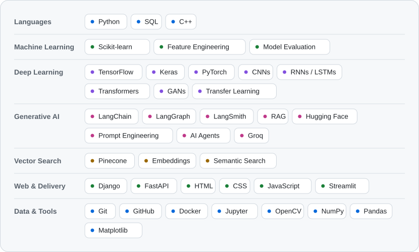
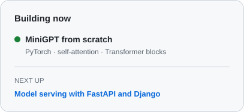
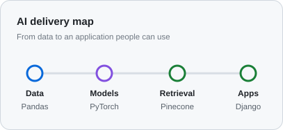
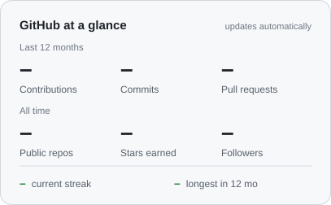
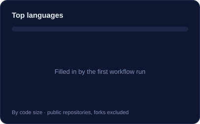
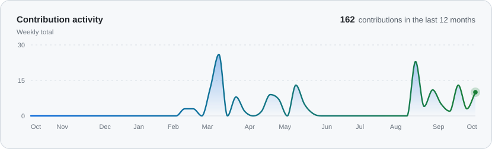
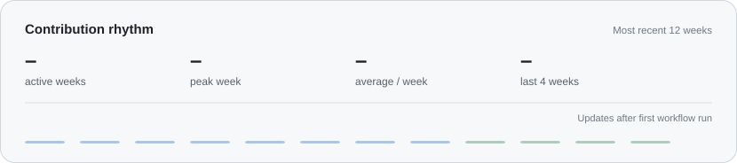

<picture>
  <source media="(prefers-color-scheme: dark)" srcset="assets/banner-dark.svg" />
  
</picture>

  <a href="mailto:himanshuchandrakar465@gmail.com"><picture><source media="(prefers-color-scheme: dark)" srcset="assets/btn-email-dark.svg" /></picture></a>
  <a href="https://www.linkedin.com/in/himanshu-chandrakar-a7b48b222/"><picture><source media="(prefers-color-scheme: dark)" srcset="assets/btn-linkedin-dark.svg" /></picture></a>
  <a href="https://github.com/himanshuchandrakar465"><picture><source media="(prefers-color-scheme: dark)" srcset="assets/btn-github-dark.svg" /></picture></a>

## AI/ML engineer focused on useful products

I build practical AI systems - from preparing data and training deep-learning models to retrieval, agent workflows, and deployable applications. My recent work combines LLM applications, vector search, and computer vision with a clear focus on reliable, usable outcomes.

<table>
  <tr>
    <td width="33%"><b>Current focus</b> LLM applications, RAG, LangGraph agents</td>
    <td width="33%"><b>Education</b> B.E. Computer Science, BIT Raipur (2021-2025)</td>
    <td width="33%"><b>Achievement</b> GATE 2025 DS &amp; AI - AIR 14,076</td>
  </tr>
</table>

## Skills and tools

<picture>
  <source media="(prefers-color-scheme: dark)" srcset="assets/tech-stack-dark.svg" />
  
</picture>

## Building now

  <picture>
    <source media="(prefers-color-scheme: dark)" srcset="assets/now-dark.svg" />
    
  </picture>
  <picture>
    <source media="(prefers-color-scheme: dark)" srcset="assets/delivery-map-dark.svg" />
    
  </picture>

## Selected work

<table>
  <tr>
    <td width="50%" valign="top">
      <b>News Brief Desk</b> 
      Streamlit · LangChain · Pinecone · Groq · Tavily
        
      An AI-assisted newsroom workflow that separates research from writing. Retrieval through Pinecone and embeddings supports grounded answers; Groq and Tavily help turn research into publishable drafts.
    </td>
    <td width="50%" valign="top">
      <b>Agentic AI Research Assistant</b> 
      LangChain · LangGraph · LangSmith
        
      A stateful research agent that plans tasks, uses tools and memory, and passes results through a multi-step LangGraph workflow. LangSmith traces support straightforward debugging.
    </td>
  </tr>
  <tr>
    <td width="50%" valign="top">
      <b>PixelBoost</b> 
      TensorFlow · Keras · OpenCV
        
      A 5.2M-parameter Residual U-Net for image de-pixelation. Residual blocks and skip connections preserve fine detail across model, training, and inference stages.
    </td>
    <td width="50%" valign="top">
      <b>Plant Disease Classification</b> 
      TensorFlow · Keras · OpenCV
        
      A custom CNN for 128×128 plant-disease images, trained with a tf.data pipeline and checkpoints. The evaluated model reached approximately 95% accuracy and 90% recall.
    </td>
  </tr>
  <tr>
    <td width="50%" valign="top">
      <b>RAG Document Q&amp;A</b> 
      LangChain · Hugging Face
        
      A document question-answering pipeline that retrieves relevant context with embeddings and semantic search, then grounds LLM responses in the source material.
    </td>
    <td width="50%" valign="top">
      <b>MiniGPT</b> (in progress) 
      Python · PyTorch · Transformers
        
      A compact GPT built from scratch to deepen understanding of self-attention, Transformer blocks, training loops, and text generation.
    </td>
  </tr>
</table>

See more in my [GitHub repositories](https://github.com/himanshuchandrakar465?tab=repositories).

## GitHub activity

  <picture>
    <source media="(prefers-color-scheme: dark)" srcset="assets/stats-dark.svg" />
    
  </picture>
  <picture>
    <source media="(prefers-color-scheme: dark)" srcset="assets/languages-dark.svg" />
    
  </picture>

  <picture>
    <source media="(prefers-color-scheme: dark)" srcset="assets/activity-dark.svg" />
    
  </picture>

  <picture>
    <source media="(prefers-color-scheme: dark)" srcset="assets/rhythm-dark.svg" />
    
  </picture>

  <picture>
    <source media="(prefers-color-scheme: dark)" srcset="assets/snake-dark.svg" />
    
  </picture>

  Activity widgets refresh daily from the GitHub API. The contribution snake is generated by GitHub Actions.

---

  Open to AI/ML engineering opportunities · <a href="mailto:himanshuchandrakar465@gmail.com">himanshuchandrakar465@gmail.com</a>

